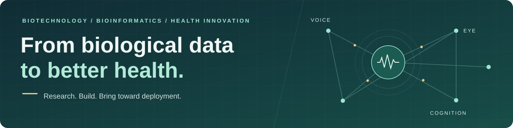

<h1 align="center">Jamyang Ugyen Tshomo</h1>

<strong>Biotechnology · Bioinformatics · Machine Learning · Health Innovation</strong>

  <a href="https://www.linkedin.com/in/jamyangut/">LinkedIn</a> ·

  <a href="https://github.com/JamyangUT/JamyangTshomo.io">Portfolio source</a> ·

  <a href="#selected-research">Research</a> ·

  <a href="#experience">Experience</a>

I am **Co-founder and COO of Biotech Wallah Pvt Ltd**, where we are building an **early cognitive screening tool using voice, eye, and cognitive biomarkers**. My work connects experimental biology, computational research, and the clinical and operational work needed to bring health technologies toward deployment.

From **Bhutan** · **B.Tech in Biotechnology, NIIT University (2022–2026)** · **CGPA: 9.8/10** · **B.Tech program-level bronze medalist**

## What I’m building

### Early cognitive screening · Biotech Wallah Pvt Ltd

We are developing a screening tool that brings together **voice, eye, and cognitive biomarkers** for early cognitive screening.

As **Co-founder and COO**, I work on regulatory strategy, clinical validation planning, data governance, and go-to-market strategy, including hospital partnerships to support clinical benchmarking.

## Selected research

| Project | Approach | Research outcome |

| :--- | :--- | :--- |

| **[Lung cancer biomarker discovery](https://github.com/JamyangUT/lung-cancer-biomarker-discovery)** · 2025 | Multi-dataset GEO analysis; Random Forest, LASSO, SVM, and Decision Trees; network and enrichment analysis | Identified **TOP2A, PRC1, and MCM4** as candidate biomarkers. **First-author [IEEE publication](https://doi.org/10.1109/ICRITO66076.2025.11241354)** at ICRITO 2025. |

| **[Keratoconus RNA-Seq analysis](https://github.com/JamyangUT/keratoconus-rnaseq-analysis)** · 2024 | 10 keratoconus vs. 10 control myopia samples; FastQC, HISAT2, featureCounts, EdgeR, and functional enrichment | Prioritized **FUBP3, ZC3H11A, DYNC1LI2, and RNMT** as candidates for further study. |

I led both projects from start to finish, working with the collaborators and mentors credited in the project repositories. These repositories document the research; the original code and Galaxy exports are unavailable.

<strong>Lung cancer study — methods and contribution</strong>

**Integrative Bioinformatics and ML Strategy for Identifying Lung Cancer Biomarkers**

- Led the study from planning through analysis, interpretation, and reporting. The documents reference ten GEO accessions and describe an eight-dataset discovery analysis; the exact subset remains to be established.

- Applied Random Forest, LASSO, SVM, and Decision Tree approaches for biomarker investigation.

- Used STRING, Cytoscape, and MCODE for interaction network analysis, alongside GO and KEGG enrichment.

- Presented the study at the 12th International Conference on Reliability, Infocom Technologies and Optimization (ICRITO 2025), Amity University, Noida.

<strong>Keratoconus study — workflow and contribution</strong>

**RNA-Seq Data Analysis of Keratoconus and Control Myopia Patients**

- Led the capstone project with Rainy Varshney under Dr. Utkarsh Raj's mentorship.

- Conducted literature review, sequencing quality control with FastQC, alignment with HISAT2, and gene-level quantification with featureCounts.

- Analyzed differential expression with EdgeR using FDR, p-value, and log fold-change filters.

- Investigated corneal degeneration hypotheses through Gene Ontology, Reactome, WikiPathways, and KEGG enrichment.

- Used NCBI, GEO, and Galaxy as data and workflow resources.

## Experience

**Research Intern · INMAS, DRDO** | January–July 2026

Worked in the **Radiation Biosciences Division** at INMAS, DRDO, with **Dr. I Prem Kumar**. Investigated gamma radiation-induced developmental toxicity and neurotoxicity in zebrafish models, and evaluated cystamine dihydrochloride as a candidate radioprotective countermeasure. Performed apoptosis assays, neural crest development analysis, intracellular ROS measurements, and RNA expression analysis.

**Summer Intern · CSIR-CCMB** | May–July 2025

Studied **[cholesterol depletion in lovastatin-treated Neuro2a and HN2 cells](https://github.com/JamyangUT/neuronal-cholesterol-modulation)** through BCA, MTT, and Amplex Red assays. Compared 24- and 48-hour exposure durations, quantified protein-normalized cholesterol, and analyzed experimental data using GraphPad Prism. Supervised by Prof. Amitabha Chattopadhyay, with guidance from Dr. Shishu Pal Singh.

## Tools and methods

  

  

  

  

  

| Area | Tools and methods |

| :--- | :--- |

| **Transcriptomics** | RNA-Seq, FastQC, HISAT2, featureCounts, EdgeR, limma, differential expression, multi-dataset analysis |

| **Machine learning** | Random Forest, LASSO, SVM, Decision Trees |

| **Biological interpretation** | GEO, NCBI, TCGA, STRING, Cytoscape, MCODE, Enrichr, Reactome, WikiPathways, KEGG, Gene Ontology, Galaxy |

| **Experimental research** | Zebrafish experimentation, cell culture, PCR, microscopy, quantitative assays |

| **Research software** | GraphPad Prism, SnapGene, SwissDock, AutoDock |

| **Health-tech operations** | Regulatory strategy, clinical validation design, data governance, go-to-market planning |

## Recognition

- **B.Tech program-level bronze medalist**, NIIT University · **CGPA: 9.8/10**

- **Winner**, Boltzhack Hackathon 2025

- **Winner**, Enigmatic Enclave Business Case Study Competition, BITS Pilani · 2025

- **First Runner-up**, Hult Prize NU · 2022

- **First Runner-up**, National Science Day Quiz · 2025

- **Best Interdisciplinary Head**, Learner’s Premier League · 2022

## Beyond research

My [personal digital portfolio](https://github.com/JamyangUT/JamyangTshomo.io) uses HTML, CSS, and JavaScript to bring together my projects, skills, and experience.

I’m interested in connecting with people working in **bioinformatics, biomedical machine learning, and health-tech**. [Connect on LinkedIn →](https://www.linkedin.com/in/jamyangut/)

